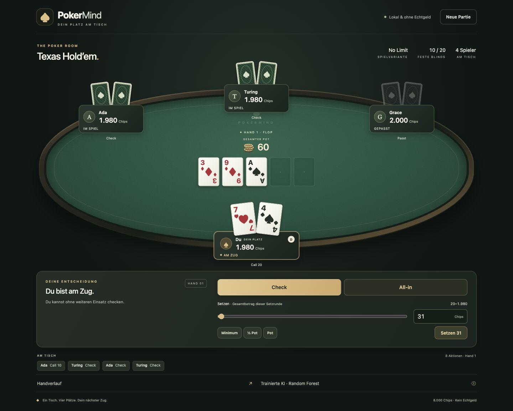
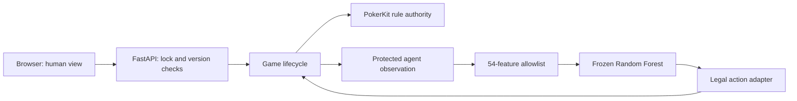

# PokerMind

[](https://github.com/ardacgu/PokerMind/actions/workflows/tests.yml) · [Repository](https://github.com/ardacgu/PokerMind) · [v1.0.0 release](https://github.com/ardacgu/PokerMind/releases/tag/v1.0.0)

## 1. Overview

PokerMind is a local **No-Limit Texas Hold'em** school project in AI systems development: one human plays against three trained computer opponents. It combines a rules engine, a self-developed simulation-based TeacherAgent, reproducible supervised learning and an independently evaluated Random Forest. Submission target: **18 December 2026**.

The model imitates a heuristic teacher. It is not an optimal poker strategy, does not learn while you play and is not intended for real-money gambling. The interface is German; technical documentation is English. A German technical completion report is provided separately.

## 2. Features

- Four permanent seats, 2,000 starting chips each, fixed 10/20 blinds and a documented moving-button convention.
- PokerKit-controlled legal actions, all-ins, side pots, split pots, elimination and heads-up play.
- Three frozen `imitation-v1` LearnedAgents by default; explicit Teacher and rule-based alternatives.
- Responsive green-felt table, clear cards, public action history, legal bet sizing, keyboard support and reduced motion.
- Protected observations, server-side validation, stale-command rejection and safe reconnect behavior.
- Included models, datasets, fixed splits, evaluation checkpoints, figures and verification evidence.

## 3. Screenshots



[Mobile side-pot view](docs/stage7/phone-390-side-pots.png) · [Split pot](docs/stage7/laptop-1280-split-pot.png) · [Screenshot gallery](docs/stage7/screenshots.html) · [UI verification](docs/ui-report.md)

Screenshots are actual browser captures. Rare-case fixtures are labeled in the gallery; they are not playing-strength measurements. No external images or web fonts are needed.

## 4. Technologies

| Component | Technology |
| --- | --- |
| Runtime | Python 3.11; recorded environment 3.11.9 |
| Poker rules and hand ranking | PokerKit 0.7.7 |
| Local HTTP server | FastAPI, Uvicorn |
| Machine learning | scikit-learn 1.7.2, NumPy, SciPy, joblib |
| Interface | HTML, CSS, native JavaScript modules; no frontend build dependencies |
| Verification | pytest; Node.js built-in test runner, tested with 24.15.0 |
| Optional figures | Matplotlib 3.9.0 |

All application/test dependencies are pinned in [requirements.txt](requirements.txt). Node is only needed for JavaScript tests, not gameplay. [Third-party notices and license status](docs/third-party-notices.md) distinguish library licenses from the owner's still-open project license decision.

## 5. Project architecture



PokerKit alone determines rule legality and payouts. Our code owns tournament lifecycle, protected views, strategies, simulation, data collection, model integration and the interface. Agents receive only permitted observations, never the live deck, hidden opponent cards or future cards. See [architecture](docs/architecture.md).

## 6. How the AI works

**RuleBot** uses fixed, deliberately simple card and call-budget rules. It is a comparison opponent, not the trained model. **TeacherAgent** samples 128 possible unknown-card completions per decision and combines estimated eligible pot shares with a programmed heuristic. Its simulation assumes uniform unknown hands and no future betting; it does not solve poker.

**LearnedAgent** extracts 54 permitted features and calls a saved Random Forest. During training, scikit-learn constructed the forest's **200 decision trees from the training data**, using bootstrap samples and random feature subsets. We did not hand-code those 200 trees. Our implementation defines the data, features, candidate actions, experiment and safe legal adapter. The fitted model is loaded once per server process and remains unchanged during normal play. It does not call the Teacher during inference.

Class scores predict Teacher action labels, not hand-winning probabilities. The adapter removes illegal candidates before selecting an action; PokerKit validates the resulting command again. [Teacher specification](docs/teacher.md) · [Model Card](docs/model-card.md)

## 7. Dataset and feature engineering

The released corpus contains **20,024 accepted Teacher decisions from 252 independently seeded sessions**. Sessions continue through at most 12 complete hands, with a mixture of four-Teacher and two-Teacher/two-RuleBot tables.

| Split | Sessions | Decisions |
| --- | ---: | ---: |
| Training | 176 | 14,156 |
| Validation | 38 | 2,811 |
| Test | 38 | 3,057 |

All decisions from a session stay in one group. Assignment is deterministic and frozen; labels did not influence splitting. The 54 integer features describe own cards, public board, position, public stacks/contributions and legal actions. Teacher estimates, hidden cards, future outcomes, IDs and random seeds are excluded. No learned preprocessing is required for these validated tree inputs.

The action classes are `fold`, `check`, `call`, `small`, `large`, `all_in`. The last class has only **21 examples, including four in test**. Short all-in calls remain `call`, and clipped raises can remain `small`/`large`, so the class count is not total all-in activity. [Data quality](docs/data-quality.md) · [Feature/action schema](docs/data-schema.md)

## 8. Model training

A predeclared comparison fitted a Dummy prior baseline, six Decision Trees and six 200-tree Random Forests. Hyperparameters and class weights were selected using validation data only. The chosen model has depth 20, minimum leaf size 3 and balanced class weights. The exact train-only artifact was saved before testing; it was not refitted on training plus validation.

Selection used legal-filtered Macro-F1 over the five non-`all_in` classes, while six-class scores and every class's support remained visible. The weak rare class was not removed from test data. [Training report](docs/training-report.md) · [Frozen experiment](experiments/imitation-v1.json)

## 9. Model evaluation

| Model | Test accuracy after legal filtering | Five-class Macro-F1 |
| --- | ---: | ---: |
| Dummy prior baseline | 59.63% | 0.2938 |
| Selected Decision Tree | 76.55% | 0.7222 |
| Selected Random Forest | **78.70%** | **0.7360** |

These scores measure **Teacher imitation**, not the probability of winning a hand. None of the three models correctly predicted the standalone `all_in` class on its four test targets.

A separate playing evaluation completed **176 sessions and 12,601 hands**: 100 regular tournament finishes, 76 hand-limit endings and no errors. Against three rule opponents, Learned averaged **+4,445.31 chips per session** and Teacher **+4,413.17**. Their paired difference was +32.15, with a 95% seed-block bootstrap interval of **−551.87 to +631.24**. No performance difference was resolved under these conditions; this does not prove equivalence. The supplementary mixed lineup suggested a Teacher advantage, with only eight independent blocks.

[Results and figures](docs/results-summary.md) · [Full evaluation and uncertainty](docs/evaluation-report.md). Neither imitation accuracy nor these bounded tournament results establish optimal poker or general superiority.

## 10. Installation

Clone the repository or extract the release ZIP, then enter the `PokerMind` directory.

```bash
git clone https://github.com/ardacgu/PokerMind.git
cd PokerMind
```

 Use Python **3.11**; the saved-model loader checks compatible versions.

```bash
python3.11 -m venv .venv
source .venv/bin/activate
python -m pip install -r requirements.txt
python -m uvicorn pokermind.server:app --host 127.0.0.1 --port 8000
```

Open **http://127.0.0.1:8000**. Keep Terminal open; Control-C stops the server. Later launches only need environment activation and the last command. If `python3 --version` reports 3.11, `python3` may replace `python3.11`. On Windows, create the environment with `py -3.11 -m venv .venv` and activate `.venv\Scripts\activate`; Windows gameplay has not been independently browser-tested.

No keys, accounts, cloud services or network access are needed during play. Dependency installation needs Internet access. Use one server process and loopback; do not add multiple workers. An occupied port can be replaced with `--port 8001`. The default model path resolves relative to the project, not a personal directory.

```bash
# Optional explicit opponent modes; restart the server when switching:
POKERMIND_BOTS=learned python -m uvicorn pokermind.server:app --host 127.0.0.1 --port 8000
POKERMIND_BOTS=teacher python -m uvicorn pokermind.server:app --host 127.0.0.1 --port 8000
POKERMIND_BOTS=baseline python -m uvicorn pokermind.server:app --host 127.0.0.1 --port 8000
```

These environment-prefix examples use a POSIX shell. Only load the included trusted joblib artifacts; joblib is not a safe format for arbitrary downloaded models.

## 11. How to play

1. Select **Erste Hand starten** (start first hand). Your seat is at the bottom; gold outlines mark the actor and **D** marks the dealer.
2. Use **Passen** (fold), **Check**, **Mitgehen** (call), **Setzen** (bet), **Erhöhen auf** (raise to) or **All-in** when offered. Call shows the additional cost.
3. Raise-to is the **total amount for the current betting street**, not an increment. Enter a whole number within the bounds, use the slider, or choose a clamped preset.
4. Side-pot labels show live collected layers. **AUSGEZAHLT** and result rows show settled gross receipts and net hand change. Opponent cards appear only when rules permit.
5. Select **Nächste Hand** to continue. Eliminated humans may watch the remaining players. **Neue Partie** opens a reset confirmation; Escape cancels.

The footer shows the actual server opponent mode and expandable model information. Tab/Shift-Tab navigate, Enter/Space activate buttons and arrow keys move the slider. The first skip link leads to actions. System reduced-motion preferences are respected. Phones and high zoom use vertical scrolling. Requests temporarily lock controls; reconnect fetches state without automatically repeating a bet. Server shutdown loses the in-memory game.

## 12. Running tests

```bash
python -m pip check
python -m pytest -q
node --test tests/ui.test.mjs
python scripts/stage8_verify.py
```

The local acceptance baseline is **68 Python + 7 JavaScript tests**, including the original rules, privacy, model, evaluation and UI tests. A single preexisting Starlette/httpx deprecation warning is documented. The GitHub workflow uses one standard Ubuntu job with pinned Python/Node versions and action commits; it runs tests and artifact/document checks, not expensive training or a complete evaluation. [Final verification](docs/final-report.md)

## 13. Reproducing experiments

Start with read-only checks that use the delivered frozen data/model:

```bash
python -m pokermind.data.pipeline validate --output data/main-v1
python -m pokermind.learning.inference --model models/imitation-v1 \
  --observation models/imitation-v1/example-observation.json
python -m pokermind.learning.evaluate_saved --model models/imitation-v1 --data data/main-v1
```

[Reproduction guide](docs/reproducibility.md) gives separate commands for independent generation, training and full evaluation in **new output directories**. Stage 6 provenance includes its original UI runtime; its preserved source archive supports exact historical reconstruction. Do not overwrite frozen outputs or bypass fingerprint checks. Optional plotting requirements are separate from gameplay.

## 14. Project structure

```text
pokermind/           Game, observations, strategies, HTTP server and UI
  teacher/           Monte Carlo estimates and programmed Teacher heuristic
  data/              54-feature schema, collection, validation and splits
  learning/          Model comparison, saved inference and legal adaptation
  evaluation/        Seed-block/seat-rotation experiment runner
models/imitation-v1/ Frozen selected model, finalists and measured results
data/                Main/pilot datasets and separate targeted scenarios
evaluations/         Original playing-evaluation checkpoints and provenance
experiments/         Frozen training and evaluation configurations
tests/               Python regression tests and JavaScript UI tests
scripts/             Reproduction, reporting and release-verification utilities
docs/                Current guides, stage reports, figures and acceptance evidence
.github/workflows/   Continuous test workflow
```

All required data and the model are ordinary Git files; no paid storage or Git LFS setup is needed. The largest artifact is about 43.3 MB. Duplicate selected/finalist model bytes are retained because original selection manifests refer to both. Release ZIPs are attached separately; the small frozen Stage 6 runtime archive is necessary provenance, not a redundant project ZIP.

## 15. Limitations

The Teacher assumes uniform unknown opponent holdings, uses finite sampling and ignores future betting when valuing actions. Imitation inherits these assumptions and adds approximation errors. Training states, rare labels, short dataset sessions and a narrow opponent family limit generalization. Small independent evaluation-block counts and high variance constrain performance conclusions.

The application supports one local, in-memory table, fixed blinds and its documented moving-button convention. It has no accounts, persistence, real money or multiplayer. Physical touch devices, screen-reader speech and every browser/OS combination were not tested. Model changes require a new separately documented experiment; the delivered scientific results remain frozen. The owner's project license decision remains open.

## 16. CRISP-DM development process

The project covers **Business Understanding, Data Understanding, Data Preparation, Modeling, Evaluation and Deployment** with links to actual artifacts and limitations in the [complete CRISP-DM report](docs/crisp-dm.md).

[Final English report](docs/final-report.md) · [German completion report](docs/abschlussbericht.md) · [Historical evidence index](docs/history/README.md)
