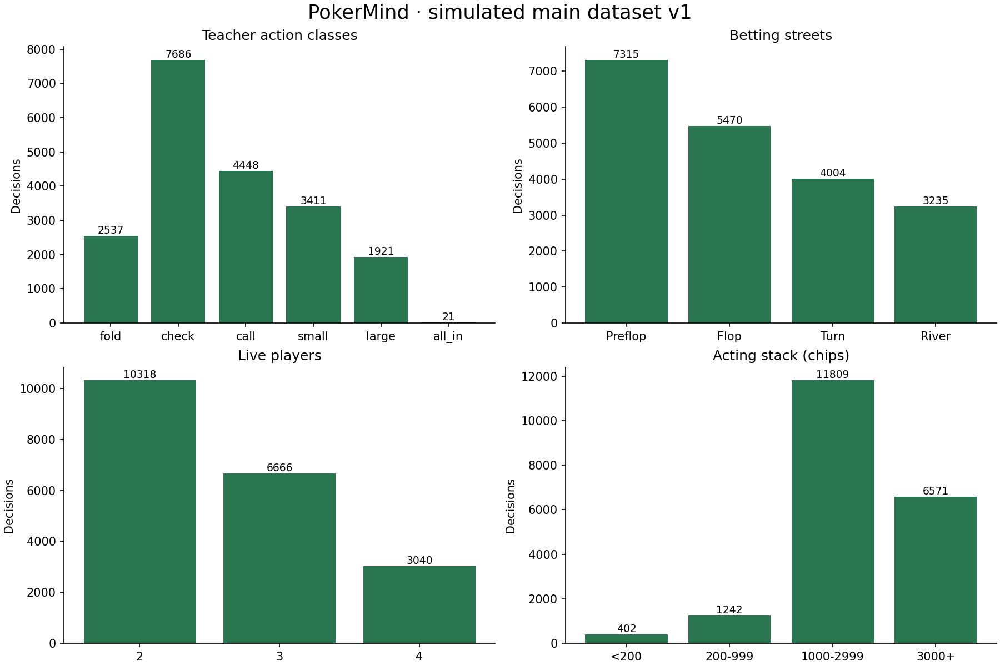

# Stage 3 data quality report

All data are simulated. Labels are decisions of our self-developed heuristic Teacher, not proven optimal poker moves. The future model will imitate this teacher. **No model has been trained or shown to play well.**

## Actual release

Generated **20,024** Teacher decisions; accepted **20,024** from **252 independent sessions**. Excluded **0**; no fallback or invalid row was silently used as a target. All 8,000 chips remained conserved during generation. Every saved session ends at a completed hand, either a winner or the explicit 12-hand limit. Even sessions contain four Teachers; odd sessions contain two rotating Teachers and two deterministic RuleBots. All main labels use teacher-2.0.0, 128 samples and the configuration in the manifest.

Main generation wall duration from first generation config write to final atomic checkpoint: **291.71 seconds**. Summed worker session times: **902.20 seconds**, a different quantity from wall duration. Four worker processes were used. Checkpoint and final export overhead are not included in summed worker time.

The pilot accepted 675 decisions from 8 sessions (target approximately 500; completed sessions caused overshoot). Its summed worker runtime was 24.17 seconds: 27.9 decisions per worker-second, or an ideal four-worker estimate of 179 seconds for 20,000 rows before overhead/uneven batches. The initial user-facing estimate was three to four minutes; actual wall duration above is authoritative. Main generation began only after pilot schema checks and the label-stability study.

## Frozen splits

| Value | Decisions | Share |
| --- | ---: | ---: |
| test | 3,057 | 15.27% |
| train | 14,156 | 70.70% |
| validation | 2,811 | 14.04% |

Group counts: train=176, validation=38, test=38. SHA-256 session-ID ordering determines approximately 70/15/15 groups without labels or outcomes. `groups.json` is frozen. All observations from all hands and actors of each session stay together. Card seeds are unique; pilot seeds 900000+ and main seeds 100000+ do not overlap. No variants of a source game family cross splits. No validation/test balancing was performed.

## Action and situation coverage

| Value | Decisions | Share |
| --- | ---: | ---: |
| all_in | 21 | 0.10% |
| call | 4,448 | 22.21% |
| check | 7,686 | 38.38% |
| fold | 2,537 | 12.67% |
| large | 1,921 | 9.59% |
| small | 3,411 | 17.03% |

| Value | Decisions | Share |
| --- | ---: | ---: |
| Flop | 5,470 | 27.32% |
| Preflop | 7,315 | 36.53% |
| River | 3,235 | 16.16% |
| Turn | 4,004 | 20.00% |

| Value | Decisions | Share |
| --- | ---: | ---: |
| 2 | 10,318 | 51.53% |
| 3 | 6,666 | 33.29% |
| 4 | 3,040 | 15.18% |

| Value | Decisions | Share |
| --- | ---: | ---: |
| 0 | 5,121 | 25.57% |
| 1 | 5,387 | 26.90% |
| 2 | 5,457 | 27.25% |
| 3 | 4,059 | 20.27% |

Position is clockwise fixed-seat distance from dealer, not compressed live-player position.

| Value | Decisions | Share |
| --- | ---: | ---: |
| 0 | 4,875 | 24.35% |
| 1 | 5,227 | 26.10% |
| 2 | 4,951 | 24.73% |
| 3 | 4,971 | 24.83% |

| Value | Decisions | Share |
| --- | ---: | ---: |
| 1000-2999 | 11,809 | 58.97% |
| 200-999 | 1,242 | 6.20% |
| 3000+ | 6,571 | 32.82% |
| <200 | 402 | 2.01% |

`call` includes short all-in calls. `small`/`large` may become all-in raises after clipping, so class `all_in` alone understates all-in activity. Pre-decision all-in-call flags: {'0': 19641, '1': 383}; short-call flags: {'0': 19750, '1': 274}; executed all-in raises: {'0': 19557, '1': 467}. Eligible-layer distribution: {'1': 13088, '2': 6126, '3': 810}. These are frozen public contribution layers, not necessarily final settled side pots. Six separate targeted legal scenarios cover short all-in calls and a certain quads shove; they were NOT merged into natural train/validation/test data. Rare classes remain rare.

## Pilot-only label stability

Selected **41** pilot observations by street/action strata: one early example and one nearest heuristic boundary per populated stratum, deduplicated. Each was reevaluated with three independent seeds at both 128 and 512 samples. Selection and full per-row outcomes are in `data/pilot-v1/stability.json`. No held-out main test observations were used for configuration selection.

At 128 samples, 11 / 41 observations changed labels across the three reevaluations; 30 / 123 reevaluations disagreed with the original pilot label. At 512 samples, these figures were 6 / 41 and 27 / 123. Study runtime: 19.51 seconds. This boundary-enriched sample estimates sensitivity, NOT population-wide noise. Higher-sample labels are not ground truth either.

Decision: freeze 128 samples for this first dataset, preserving the existing teacher behavior and practical generation cost. The remaining sampling noise is intentional and documented; boundary cases are retained. No different sample configuration is mixed into the main targets. This targeted pilot cannot establish a population-wide noise rate or an accuracy ceiling; stage 4 must not equate disagreement with bad poker play.

## Full-data audit and executed checks

The full released raw dataset was re-read and every feature recalculated from its observation. Candidate masks and concrete action mapping were reconstructed. Every label had to be legal and agree with the diagnostic decision; paid chips, actor identity, hand index and public chip totals were checked. Every accepted record had to have fallback=false. All three model files were re-read through the strict allowlisted loader. File hashes were verified with the validate command.

- Valid exported rows: 20,024; missing/invalid/inconsistent accepted feature values: **0**.
- Duplicate IDs: **0**; repeated card-seed families: **0**; cross-split session overlap: **0**.
- Exact repeated raw snapshots excluding IDs/session: **10**. Independently recurring feature vectors: **32** extra rows; feature patterns shared across splits: **15**. Conflicting-label feature patterns: **8**. All 10 exact repeated snapshots were traced to distinct independently seeded sessions (see stage3-repeat-audit.json); accidental export copies: 0. These are recurring initial situations, not repeated exports. Legitimate recurrence is retained, not removed from test.
- Fallback exclusions: **0**. Any fallback would be logged and omitted from accepted targets; unexpected engine errors abort the session instead of producing a label.
- Regression suite: **40 passed**, including all previous 36. New tests cover reproducibility, checkpoint resume without duplicate exports, observation snapshots, feature isolation, strict loading, legal decoding, short all-in-call mapping and disjoint groups. Existing Starlette/httpx deprecation warning remains.
- No training, fitted scaler, fitted feature selector, class balancing, model evaluation or new browser UI test was performed.

## Reproduction and stage 4 limits

See [schema and commands](data-schema.md). Main artifacts: `data/main-v1/manifest.json`, `schema.json`, `groups.json`, raw/diagnostic JSONL and the three model files. Manifest records configuration, independent seeds, source hashes, versions, groups, exact counts and artifact hashes. `examples.jsonl` is a documentation copy, never an extra training source. Original stage 1/2 evidence is preserved.

Uniform opponent ranges and a frozen-contribution/no-future-betting counterfactual limit teacher quality. The main data overrepresent heads-up situations as players bust; fixed blinds and 12-hand sessions constrain coverage. Sampling noise, rare all-in class, class imbalance and policy-dependent state distribution matter in stage 4. Fit transformations only on train; use validation for choices and preserve test for final evaluation. Do not claim strength from imitation accuracy. Keep targeted scenario scores separate from natural held-out scores.

## Split-level action counts

44 sessions ended with a winner; 208 reached the complete-hand limit.

| Class | Train | Validation | Test |
| --- | ---: | ---: | ---: |
| fold | 1792 | 348 | 397 |
| check | 5453 | 1084 | 1149 |
| call | 3157 | 617 | 674 |
| small | 2368 | 487 | 556 |
| large | 1371 | 273 | 277 |
| all_in | 15 | 2 | 4 |
