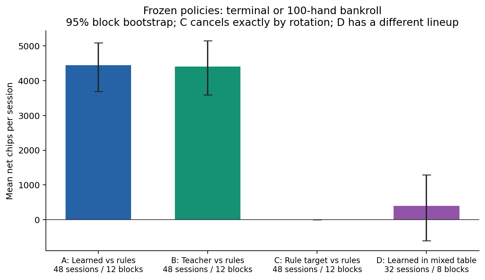
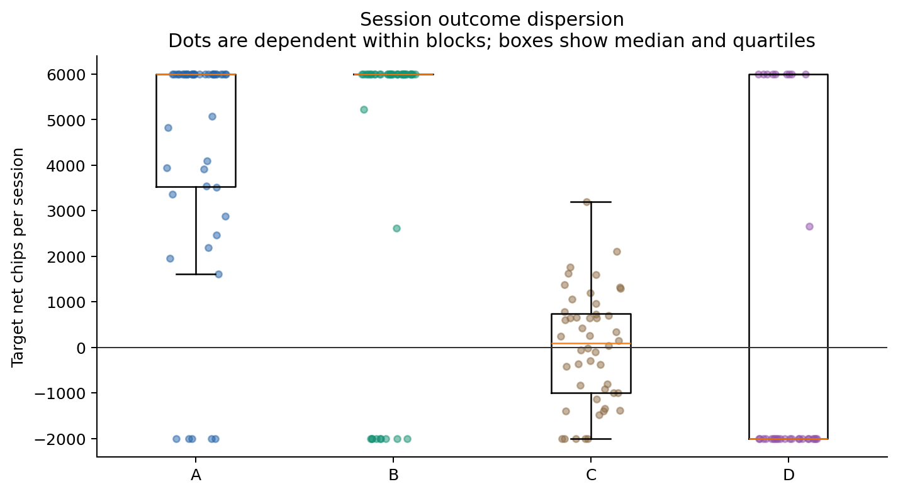
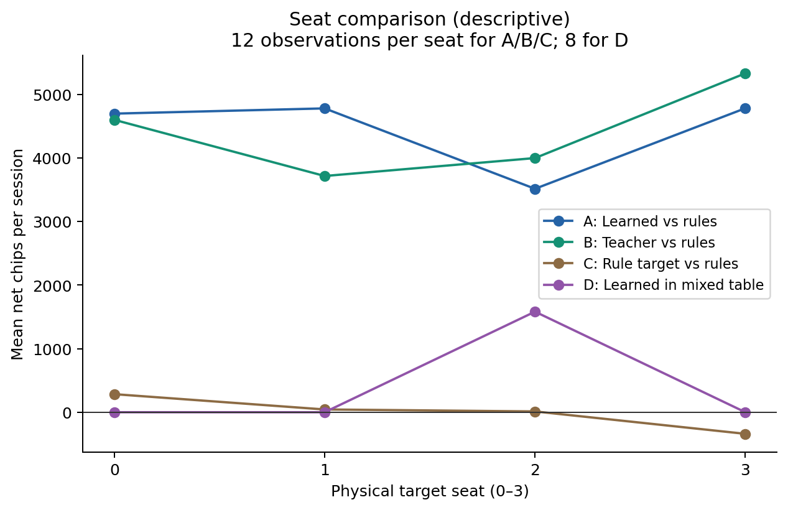
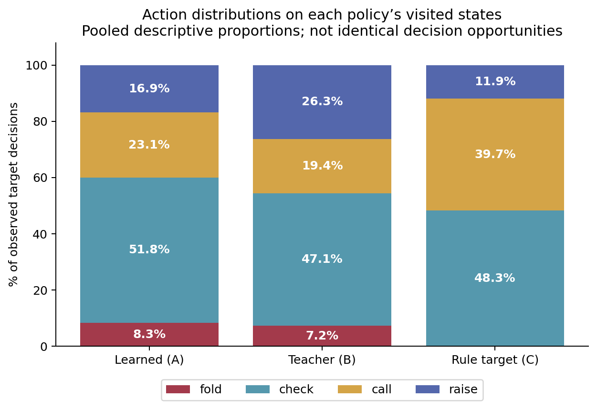
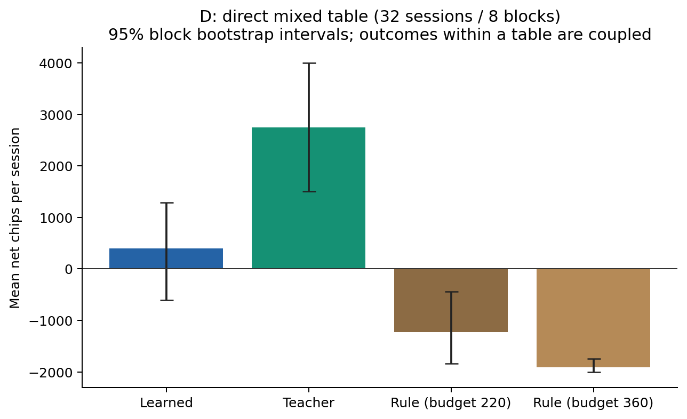

# Stage 6 — Independent playing-strength evaluation

## Finding and scope

The frozen LearnedAgent gained **4,445.31 chips per session** against three existing rule opponents; the Teacher gained **4,413.17** under the same protocol. The paired Learned-minus-Teacher difference was **+32.15 chips**, with a 95% seed-block bootstrap interval of **[−551.87, +631.24]**: this experiment does not resolve a difference against these opponents and does not establish equivalence. Both show positive performance in this specific bounded setup.

In the supplementary mixed table, the Teacher averaged **+2,750.00** and Learned **+395.63**. Learned-minus-Teacher was **−2,354.38**, interval **[−4,604.38, −208.75]**. This is an exploratory indication of a Teacher advantage in that lineup, based on only eight independent blocks. It is not a general ranking of poker strategies.

All **176 planned sessions / 12,601 completed hands** were executed: **100 regular tournament finishes, 76 hand limits, zero error sessions**. This is CRISP-DM **Evaluation**. No training, model selection, Teacher change, split change or UI redesign occurred. The prior **78.70% test accuracy** measures imitation of Teacher labels; it is a different endpoint. Neither measurement demonstrates optimal or equilibrium poker.

## Frozen protocol and implementation

The [pre-run protocol](../experiments/evaluation-protocol.md) and [configuration](../experiments/evaluation-v1.json) define the experiment. `pokermind/evaluation/` is a separate adapter over the same Game/PokerKit lifecycle and policy interface used by the existing simulator. The original `simulation.play`, browser flow, Game rules, Teacher and LearnedAgent implementations remain unchanged.

Each table starts with four stacks of 2,000; blinds stay 10/20, no rake/antes. The original moving button and transition to heads-up are retained. A session ends after a fully settled hand when a single survivor exists, otherwise after 100 fully settled hands. A target bust does not stop the remaining tournament. Capped sessions have no champion, even if one player leads. Error sessions retain the last settled bankroll and incomplete-hand marker, are never silently replaced, and would be excluded from strength summaries; none occurred.

| Scenario | Clockwise roster before cyclic rotation |
| --- | --- |
| A | Learned target; Rule 120; Rule 220; Rule 360 |
| B | Teacher target; Rule 120; Rule 220; Rule 360 |
| C | Rule 120 target; Rule 120; Rule 220; Rule 360 |
| D | Learned target; Teacher; Rule 220; Rule 360 |

Rule numbers are the existing weak-call budgets. Identity/style stays fixed while the whole roster rotates over seats 0–3. C measures a particular marked conservative RuleBot, not an average over rule styles. D rotates the Teacher too, always immediately clockwise from Learned; alternative relative arrangements were not evaluated.

A/B/C use the same twelve blocks 6000001–6000012, four rotations each (48 sessions per scenario). D uses 6000001–6000008, four rotations each (32 sessions). These are independent of the original data-generation block seeds 100000–100251. D shares the first eight block numbers with the main scenarios; it is not an additional independent sample of twelve blocks.

For each hand, the first eight SHA-256 bytes of `deck|block|hand` seed a fresh Python Random shuffle. The permutation is common across scenarios and rotations for that hand number. Teacher has a separate per-session stream seeded from `agent|block|rotation|identity`; RuleBots and the forest have no decision-time sampling. No agent can consume deck RNG draws. Policies receive only detached `observe(game, seat)` projections, never deck seeds, future cards or concealed opponent cards. Legally exposed showdown cards retain the existing visibility rules.

**Pairing limits:** common permutation does not mean identical cards to the named target. Physical seats differ; eliminations change dealing order/player counts and strategies change streets reached. Subsequent deck permutations remain paired by hand number, but states and decision opportunities diverge. These are common-random-number seed-block comparisons, not identical counterfactual hands or duplicate-poker matches.

## Pilot, runtime and complete accounting

Initial pilot: 16 sessions × 8 hands = 128 hands; zero errors. Its sole subsequent implementation correction improved blind-all-in counting by reading posting operations, including instantly settled hands. The original core snapshot and results are preserved in `evaluations/stage6-pilot-initial/`.

Final pilot with frozen main-run source: another 16 sessions / 128 hands, all capped, zero errors, **4.77 s wall time**. One session per scenario was replayed (four × eight hands) and matched semantically exactly, excluding elapsed time. Both pilots and these replays are excluded from the strength sample. See `evaluations/stage6-pilot/reproducibility.json`.

The main run took **199.16 s wall time (3 min 19.16 s)** using four spawned worker processes on macOS 15.5 arm64, 10 logical CPUs, Python 3.11.9. Sum of session wall durations was 779.35 s; this is overlapping worker elapsed time, not CPU time. Per-process forest n_jobs stayed 2. Testing/report preparation and the small browser check also ran on the host; this is operational runtime, not an isolated speed benchmark. A subsequent no-op resume took 0.15 s, scheduled zero new sessions and preserved all checkpoints. No run was lost or replaced.

The symmetry audit separately replayed all 48 C sessions / 4,800 hands with identical outcomes; these are duplicate verification, not additional independent observations. API/browser acceptance hands and pytest fixtures are also excluded. Main-run session counts and elapsed times are available in the [manifest](../evaluations/stage6-v1/manifest.json).

## Outcome definition and uncertainty

Primary endpoint is final settled chips minus 2,000, including capped tournaments. Each of four rotations has equal weight. The descriptive SD below is between individual session outcomes; it is **not** divided by sqrt(48) for inference. Means are bootstrapped from complete **four-rotation seed-block means**, with 10,000 resamples, seed 6600001, NumPy default_rng/PCG64, percentile 2.5/97.5 bounds. Paired contrasts resample the same shared blocks. All planned blocks completed, so no incomplete block was dropped.

Hands within a tournament, rotations within a block and players within a table are dependent. No hand-level independent-trial analysis was used. Twelve/eight blocks are small samples; percentile intervals are approximate, sensitive to the observed seeds, and not simultaneous/multiplicity-adjusted. Seat/action/all-in analyses and D are exploratory. A zero-containing interval does not prove equality. No cashgame winrate or bb/100 claim is made. `dealt_hands` counts only settled hands in which the player received cards; session hands can continue after that player busts.

| Scenario / target | Sessions / blocks | Hands | Mean net chips | Median | Session SD | 95% block CI |
| --- | --- | --- | --- | --- | --- | --- |
| A | 48 / 12 | 3720 | 4,445.31 | 6,000.00 | 2,568.24 | [3,697.00, 5,093.96] |
| B | 48 / 12 | 2666 | 4,413.17 | 6,000.00 | 3,152.91 | [3,596.08, 5,150.56] |
| C | 48 / 12 | 4800 | 0.00 | 90.00 | 1,235.31 | [0.00, 0.00] |
| D | 32 / 8 | 1415 | 395.62 | -2,000.00 | 3,654.72 | [-604.38, 1,291.25] |

Every target range was bounded by the tournament bankroll; see summary.json for exact minima/maxima. Session outcomes are highly dispersed despite the large aggregate hand count.





### Important control-scenario symmetry

C's mean and block interval are **0 [0, 0]**, despite session SD **1,235.31**. This is a structural cancellation, not proof of universally zero uncertainty. All four rotations in every C block replay the same physical-seat hand trajectories. An additional replay checked **88,908 decisions**: all three existing RuleBot styles proposed the same action on every visited C observation. Their different call budgets did not distinguish behavior on these trajectories. Rotating the marked target through the four seats therefore averages exactly the same zero-sum bankroll vector to zero in each block. The [audit](stage6/integrity-audit.json) records this. A−C and B−C intervals consequently equal A and B's own mean intervals. Different opponents, seeds or horizons could break the behavioral symmetry.

### Completion, elimination and conditional wins

| Scenario | Regular finish | Hand limit | Errors | Target eliminated | Target wins / completed tournaments | Conditional win fraction |
| --- | --- | --- | --- | --- | --- | --- |
| A | 31 | 17 | 0 | 5/48 | 30/31 | 96.77% |
| B | 39 | 9 | 0 | 9/48 | 37/39 | 94.87% |
| C | 0 | 48 | 0 | 5/48 | 0/0 | undefined |
| D | 30 | 2 | 0 | 22/32 | 9/30 | 30.00% |

Conditional win fractions use only the tournaments that actually ended within the horizon. They are duration-selected, not unbiased eventual tournament win probabilities. C's fraction is undefined, not 0%. For example, A has five target eliminations but only one observed target loss among completed tournaments; the other busted-target sessions remained capped. A hand limit is never converted to a victory.

### Paired performance contrasts

| Paired contrast | Independent blocks | Mean chip difference | 95% block CI |
| --- | --- | --- | --- |
| A-B | 12 | 32.15 | [-551.87, 631.24] |
| A-C | 12 | 4,445.31 | [3,697.00, 5,093.96] |
| B-C | 12 | 4,413.17 | [3,596.08, 5,150.56] |
| D learned-teacher | 8 | -2,354.38 | [-4,604.38, -208.75] |

In this setup, Learned and Teacher both beat the simple RuleBot field on the primary bankroll endpoint. There is no resolved A/B performance gap. The mixed-table contrast points toward Teacher, subject to the supplementary small-sample limitations. The A/B result and D result concern different lineups and need not agree.

## Seat patterns

| Scenario | Seat 0 | Seat 1 | Seat 2 | Seat 3 |
| --- | --- | --- | --- | --- |
| A | 4,699.33 | 4,781.75 | 3,516.50 | 4,783.67 |
| B | 4,601.67 | 3,717.67 | 4,000.00 | 5,333.33 |
| C | 284.17 | 43.33 | 12.50 | -340.00 |
| D | 0.00 | 0.00 | 1,582.50 | 0.00 |

A/B/C each have 12 observations per physical seat; D has eight. Learned's A seat 2 is lower than the other seats, whereas its D seat 2 is higher. Teacher's B seat 3 is highest. These are measured fluctuations, not evidence of a consistently advantageous physical seat. The starting dealer is fixed and moves normally; physical seat is not the same as always being button/small blind. A longer independently seeded evaluation and predeclared positional hypotheses would be needed to diagnose a positional defect.



## Decisions and all-in patterns

| Target | Decisions | Fold | Check | Paid call | Raise / bet |
| --- | --- | --- | --- | --- | --- |
| A | 11693 | 971 (8.30%) | 6,052 (51.76%) | 2,696 (23.06%) | 1,974 (16.88%) |
| B | 7176 | 520 (7.25%) | 3,381 (47.12%) | 1,390 (19.37%) | 1,885 (26.27%) |
| C | 22227 | 0 (0.00%) | 10,739 (48.32%) | 8,833 (39.74%) | 2,655 (11.94%) |
| D | 3966 | 300 (7.56%) | 2,092 (52.75%) | 875 (22.06%) | 699 (17.62%) |

These are pooled descriptive action counts on each policy's own visited states, without independent-decision confidence intervals. A raise includes an opening bet. Differences in survival, hand length, opponent reactions and state distribution confound any causal interpretation. In A, Learned checks most often (51.76%), raises less often than Teacher in B (16.88% versus 26.27%), and uses folds least often among its common actions (8.30%). C has no folds in these trajectories, consistent with the verified style symmetry.



| Canonical label | Learned A | Teacher B | Learned D | Teacher D |
| --- | --- | --- | --- | --- |
| fold | 971 | 520 | 300 | 195 |
| check | 6052 | 3381 | 2092 | 1273 |
| call | 2696 | 1390 | 875 | 512 |
| small | 742 | 1062 | 290 | 437 |
| large | 1232 | 811 | 409 | 350 |
| all_in | 0 | 12 | 0 | 5 |

Learned never chose the standalone `all_in` class in A or D; Teacher did so 12 times in B and five times in D. This is consistent with concern about only 21 standalone all-in labels in the generated corpus (15 in training), but the evaluation does not establish the cause. The class is **not** the same as committing all remaining chips.

| Target | Dealt hands | All-in actions | Calls / raises | Blind all-ins | All-in hands | Facing all-in decisions | Standalone all_in label |
| --- | --- | --- | --- | --- | --- | --- | --- |
| A | 3367 | 34 | 4 / 30 | 1 | 35 | 39 | 0 |
| B | 2037 | 57 | 6 / 51 | 1 | 58 | 58 | 12 |
| C | 4612 | 7 | 4 / 3 | 0 | 7 | 34 | not applicable |
| D | 1108 | 50 | 18 / 32 | 0 | 50 | 41 | 0 |

An all-in action commits the remaining stack by call/raise, even when excess is later refunded. These annotations overlap call/raise counts; they are not extra actions. Blind all-ins are separate. `all_in_hands` counts distinct hands with either event. `facing_all_in_decisions` counts decisions with another active zero-stack player, not unique hands or exclusively calls against shoves.

Learned A made 34 all-in actions (4 calls / 30 raises), versus Teacher B's 57 (6 / 51): 0.29% versus 0.79% of their decisions. Learned D made 50 (18 / 32), despite zero standalone all_in predictions. Thus neither total absence of all-ins nor uncontrolled repeated shoving is supported by the counters. D has a different state mix and more all-in calls for Learned. No action-quality verdict follows from frequency alone; losses might involve sizing, calls, folds or prior streets. The role of rare-label weakness in D remains an untested explanation.

Across all players/scenarios: **184,808 legal applied actions, zero adapter zero-probability fallbacks, zero Teacher fallbacks, zero execution errors**. Exactly **one raw illegal model class** was removed by the unchanged legal adapter (Learned in D); this was a legal filtering correction, not a fallback or an engine error.

## Direct mixed table (D)

| Identity | Mean net chips | Median | 95% block CI | Wins / completed | Eliminated |
| --- | --- | --- | --- | --- | --- |
| rule2 | -1,230.78 | -2,000.00 | [-1,835.16, -436.88] | 2/30 | 28/32 |
| rule3 | -1,914.84 | -2,000.00 | [-2,000.00, -1,744.53] | 0/30 | 31/32 |
| target | 395.62 | -2,000.00 | [-604.38, 1,291.25] | 9/30 | 22/32 |
| teacher | 2,750.00 | 6,000.00 | [1,500.00, 4,000.00] | 19/30 | 13/32 |

The table is zero-sum across all four identities. Teacher won 19 of 30 completed tournaments, Learned nine, Rule 220 two, Rule 360 zero. Two sessions remained capped. Learned's mean above zero has a block interval crossing zero; it is not itself evidence of beating the full mixed lineup. The paired Teacher advantage is more informative than comparing two separately drawn intervals because outcomes in the same table are coupled.



## Observations, explanations and remaining uncertainty

**Observed:** positive A/B bankroll results; unresolved paired A/B gap; an exploratory Teacher advantage in D; substantial session variance; changing seat patterns; lower pooled raise frequency and no standalone all_in labels for Learned; zero runtime failures.

**Plausible explanations, not causal findings:** the elementary rules ignore board strength and may pay value bets or fold larger bets too simply. The model may smooth Teacher decisions, and its visited long-tournament/mixed-opponent states may differ from the training distribution. Lower aggression or rare-action underrepresentation could matter in D. This experiment did not intervene on those mechanisms.

**Teacher and imitation limitations:** uniform unknown-hand sampling does not infer opponent ranges from action history. Finite Monte Carlo estimates and heuristic thresholds can create noisy targets. Frozen-contribution equity does not solve future betting, opponent adaptation, bluffing balance or strategic equilibrium. Imitation can inherit these weaknesses while adding approximation errors, and 78.70% agreement cannot identify which disagreements are costly or beneficial. No observed equality against weak opponents proves equal strength against stronger ones. The model is unchanged after observing these results.

Only one blind structure, starting stack, 100-hand cap, fixed relative D arrangement and a narrow opponent family were studied. Fixed blinds leave some tournaments slow; capped bankroll and selected completed-tournament win fractions measure different things. Small block counts, seed-dependent trajectories, dependent rotation outcomes and exploratory multiple comparisons limit generalization. No real-player, cashgame, exploitability or optimal-strategy claim is supported.

## Technical verification

The existing 51 tests plus 12 new cases passed: **63 passed**, one pre-existing Starlette/httpx deprecation warning. [Full output](stage6/tests.txt). New checks cover all four actual policy lineups' reproducibility, cyclic identities/styles, separate RNG consumption, conservation, observation privacy/detachment, action attribution, legal failure handling, elimination/all-ins, true winners versus caps, fallback counters, frozen Teacher validation, checkpoint merge/resume and conflicting duplicate rejection.

Integrity verification matched **312 fingerprinted runtime/model/data files**, all **262 original dataset manifest hashes**, original selected model artifacts, Teacher/rule/schema sources and preserved selection evidence. Every one of 12,601 settled hand records conserved 8,000 chips. No missing or duplicate session ID remained.

The actual FastAPI application with three loaded LearnedAgents completed three hands, 15 game-command responses and 24 model decisions, zero errors/fallbacks; Teacher invocation was forbidden. Public cards were checked against PokerKit exposure operations. Reset and static assets worked. [API evidence](stage6/http-check.json).

A separate actual browser run on the unmodified local server completed start → four human calls → showdown → reset. All three trained opponents acted, their concealed cards stayed masked, Ada won 1,620 gross / +820 net, final stacks were 1,200 / 2,820 / 1,980 / 2,000, and reset restored four × 2,000. Seven model decisions, zero fallbacks/errors, no captured browser warning/error entries. A nonblocking favicon request returned 404; app routes/assets returned 200. The server was stopped. [Browser evidence](stage6/browser-check.json), [screenshot](stage6/browser-showdown.png). No complete visual redesign review was needed because the UI did not change; the existing stage-5 badge remains.

## Reproduce, resume and merge

From the project root, using Python 3.11 and the pinned runtime environment:

```bash
source .venv/bin/activate
python -m pip install -r requirements.txt
# Independent pilot output (existing pilot directory is preserved):
python -m pokermind.evaluation.run --config experiments/evaluation-pilot.json \
  --output evaluations/pilot-reproduction --workers 4
# Independent complete reproduction:
python -m pokermind.evaluation.run --config experiments/evaluation-v1.json \
  --output evaluations/reproduction --workers 4
# Resume the delivered experiment: currently a verified no-op, 176/176 present.
python -m pokermind.evaluation.run --config experiments/evaluation-v1.json \
  --output evaluations/stage6-v1 --workers 4
# Merge checkpoint directories with this same full config/fingerprint;
# identical sessions are deduplicated, conflicts rejected, missing jobs run.
python -m pokermind.evaluation.run --config experiments/evaluation-v1.json \
  --output evaluations/merged --merge evaluations/stage6-v1 evaluations/reproduction --workers 4
python -m pytest -q
PYTHONPATH=. python scripts/stage6_http_check.py
PYTHONPATH=. python scripts/stage6_audit.py
# Optional plotting dependency; does not change gameplay/model parameters:
python -m pip install -r requirements-report.txt
python scripts/stage6_report.py --input evaluations/stage6-v1
```

Actual figures were generated with host Python 3.11.9, NumPy 2.4.6 and matplotlib 3.9.0, matching the optional plotting requirements; versions are recorded in summary.json. `stage6_report.py` regenerates JSON/CSV summaries and PNG/SVG figures from session checkpoints, without loading agents. The English interpretation is a reviewed report tied to the delivered run, not automatically extrapolated to new configurations.

Atomic per-session checkpoints are keyed by scenario, seed and rotation. File locks prevent simultaneous writers. Source, config, model/data fingerprints must match to resume; failures are explicit. A recorded error is retained, never automatically retried. For a deliberate new experiment or corrected implementation use a new output directory and report it separately. Semantic replay equality ignores elapsed seconds only. Cross-platform bitwise floating probability equality is not claimed; environment pinning and measured action/outcome replay are the reproducibility evidence.

## Evidence layout

- `evaluations/stage6-v1/sessions/`: all 176 original session JSON checkpoints, including each player's outcomes/actions and every settled hand's bankroll, dealer and active seats.
- `sessions.jsonl`: merged, unique machine-readable records; `players.csv`: 704 player-session rows; `block-means.csv`: 44 scenario/block rows; `summary.json`: estimates, intervals, contrasts and counts.
- `config.json`, `provenance.json`, `manifest.json`: seeds/configuration, runtime and artifact hashes, versions, invocation times and completed IDs; `evidence-manifest.json` links the final report evidence by checksum.
- `docs/stage6/`: five figures in PNG and SVG, integrity audit, test/API/browser evidence. Pilots remain in their separate evaluation directories.
- `../PokerMind.zip`: complete updated portable project, including old data/models/reports and new evidence, excluding environments, caches, Git and scratch work. The archive was CRC-checked and every archived file compared byte-for-byte with the source. The extracted source/artifacts passed all 63 tests again and exactly replayed main session A-6000001-r0 (76 hands); its default learned API returned HTTP 200. This used the existing pinned runtime, not a new dependency installation. Evidence: `docs/stage6/package-check.json` and `docs/stage6/extracted-tests.txt`. The duplicated replay is excluded from strength estimates. Rebuild and byte-check with `python scripts/stage6_package.py`.
