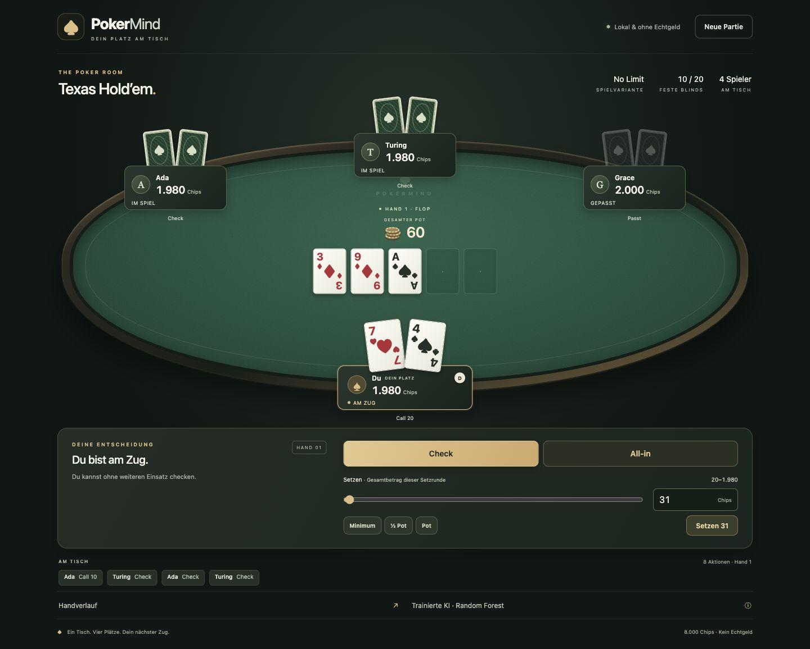

> Historical snapshot at the end of Stage 7. Relative links were adjusted for this archive location; use the current README for commands.

# PokerMind

A local, four-seat No-Limit Texas Hold'em application for a school project in AI systems development. One human plays against three **trained Random Forest opponents** using the frozen `imitation-v1` model. RuleBot and Teacher modes remain explicitly configurable. The model imitates a heuristic teacher and does not learn during play. The GitHub submission deadline is **18 December 2026**; this repository has not been published yet.



## Stage 7 — professional local poker interface

A responsive green-felt table, readable cards, public seat actions, side-pot and payout details, comfortable legal bet sizing, keyboard support and reduced motion are now available. All three opponents still use the unchanged trained Random Forest. **75 tests pass (68 Python + 7 JavaScript)**; real browser checks cover desktop, laptop, tablet, phone and actual 200% Chrome zoom.

[UI and verification report](../../docs/ui-report.md) · [screenshot gallery](../../docs/stage7/screenshots.html) · [integrity audit](../../docs/stage7/integrity-check.json). Prior reports below are historical milestones. No model, Teacher, rules, data/splits or Stage 6 result changed.


## Stage 6 — measured playing performance

The independent evaluation is complete: **176 sessions, 12,601 hands**, 100 regular tournament finishes, 76 hand limits, no errors. Against three rule opponents, Learned averaged **+4,445.31 chips** and Teacher **+4,413.17**. Their paired gap (+32.15; 95% block interval −551.87 to +631.24) was unresolved. The supplementary mixed table favored Teacher, with only eight independent blocks. These bounded tournament results are distinct from **78.70% Teacher-label accuracy** and do not establish optimal poker.

[English evaluation report](../../docs/evaluation-report.md) · [machine-readable results](../../evaluations/stage6-v1/summary.json) · [run manifest](../../evaluations/stage6-v1/manifest.json) · [configuration](../../experiments/evaluation-v1.json). **63 tests passed at Stage 6**. Frozen model, Teacher, data/splits and browser functions are preserved. Earlier stage reports below remain historical evidence.

```bash
# The old checkpoint fingerprint includes the old UI. Reconstruct its exact runtime:
mkdir -p work/stage6-replay
python -m zipfile -e evaluations/stage6-runtime.zip work/stage6-replay
cp -R models data experiments work/stage6-replay/
cd work/stage6-replay
# Use the activated pinned environment from the project root:
python -m pokermind.evaluation.run --config experiments/evaluation-v1.json \
  --output evaluations/reproduction --workers 4
# Re-running the same command resumes this reproduction without duplicates.
```

## Run on macOS

Tested with **Python 3.11.9 on macOS / Apple Silicon**. Install Python 3.11 if necessary. All packages, including transitive dependencies and test tools, are pinned in `requirements.txt`. No Node.js runtime, API keys, external assets, network calls during play, or cloud services are needed.

Open Terminal in this project's directory, then run:

```bash
python3.11 -m venv .venv
source .venv/bin/activate
python -m pip install -r requirements.txt
python -m uvicorn pokermind.server:app --host 127.0.0.1 --port 8000
```

Open **http://127.0.0.1:8000**. Keep Terminal open; press **Control-C** to stop. On later launches, only activate `.venv` and run the last command. If `python3 --version` already reports Python 3.11, `python3` can be used instead of `python3.11`. If port 8000 is occupied, use `--port 8001` and open the matching address.

The prepared local checkout already contains an installed `.venv`. Virtual environments are machine-specific and excluded from Git; recreate it after copying the project to another location or computer. Use a single server process (no `--workers` option): this is one in-memory table for one local user.

## Play

- Click **Erste Hand starten**. Each seat starts with 2,000 chips; blinds stay at 10/20.
- Your seat is at the bottom. The gold outline marks the current actor; **D** marks the dealer.
- Available buttons come directly from PokerKit's legal actions. **Mitgehen** shows the additional call amount. **Erhöhen auf** means your **total contribution on this betting street**, including chips already committed on this street. It is not the raise increment.
- Enter an integer between the displayed bounds, move the slider, or choose **Minimum**, **½ Pot**, **Pot** or **All-in**. Presets are clamped to legal raise-to amounts. A short all-in appears only when legal; it does not automatically reopen raising.
- A completed hand remains visible, with pot receipts, net change and legally exposed cards. Click **Nächste Hand** to proceed.
- Busted players are skipped. If you bust, you can continue starting hands and watch the remaining bots until one player owns all 8,000 chips.
- **Neue Partie** opens a confirmation once a hand exists. Confirm to reset all four seats, or use **Weiterspielen** / Escape to keep playing. Browser reload preserves the current table while the server runs; stopping the server does not save the game.

The total pot includes current bets. Multiple live pots are labeled Hauptpot/Seitenpot; completed **Topfauszahlung** rows identify actual recipients and split payouts. **AUSGEZAHLT** is the settled gross payout, not money still available to bet. All-in and fold labels reflect server state. The footer shows the actual opponent mode; expand it for the model version and explanation.

Use Tab/Shift-Tab and Enter/Space for controls, arrow keys on the slider, and the first keyboard skip link to jump to actions. The UI follows the system's reduced-motion preference. On phones and at high zoom, scroll to the action panel. While requests run, controls lock; a connection failure offers **Erneut verbinden** and never automatically repeats a bet. No real money is involved.

## Verify

```bash
source .venv/bin/activate
python -m pytest -q
node --test tests/ui.test.mjs  # Optional UI tests; tested with Node 24.15.0
python scripts/stage7_integrity.py
python -m pokermind.simulation --seed 1 --max-hands 2000
```

The simulator runs four baseline policies through the same game adapter and private observations. It reports whether the hand limit was reached; a cutoff is not reported as a completed tournament. Seeded tests are deterministic, while interactive play uses system randomness.

## Project map

```text
pokermind/
  game.py          Tournament lifecycle and PokerKit adapter
  views.py         Allowlisted, detached player observations
  agents.py        Decision type, Policy protocol, baseline strategy
  simulation.py    Reproducible headless evaluation entry point
  server.py        Local HTTP API, lock and stale-command rejection
  presentation.py  Read-only public actions/pots/payouts for the browser
  static/          Semantic HTML, responsive CSS, app.js and pure ui.mjs helpers
tests/             Rule integration and API regression tests
docs/              Architecture, CRISP-DM and verification evidence
```

See [architecture and rules](../../docs/architecture.md), [CRISP-DM and AI plan](../../docs/crisp-dm.md), and the [test report](../../docs/test-report.md). No dataset or trained model is claimed in stage 1. The repository includes a GitHub Actions test workflow; a remote repository, public release, and project license remain decisions for the project owners.

## Stage 2 — TeacherAgent available

A separate self-developed Monte Carlo teacher now implements the existing policy interface. No model has been trained. Enable it at the table with:

```bash
POKERMIND_BOTS=teacher POKERMIND_SAMPLES=128 POKERMIND_TEACHER_SEED=1 \
  python -m uvicorn pokermind.server:app --host 127.0.0.1 --port 8000
```

The baseline remains available explicitly; since stage 5, learned opponents are the browser default. See [Teacher strategy and reproducible commands](../../docs/teacher.md) and [stage 2 test/pilot report](../../docs/stage2-report.md). Stage 1 evidence above is historical; the current suite has 36 passing tests. The earlier baseline cutoff was investigated and the same game completes at hand 3,289 when permitted to continue.

## Stage 3 — simulated imitation data

Stage 3 adds a shared inference-time feature extractor, canonical action mapping, atomic session checkpoints, fixed session-level splits, strict model-data loading and full-data validation. The learning target is our heuristic Teacher's action, **not a proven optimal move**. No model is trained yet.

See [feature/action schema and commands](../../docs/data-schema.md) and [data quality report](../../docs/data-quality.md). The natural dataset is in `data/main-v1`; pilot diagnostics and targeted scenarios are separate. Never flatten teacher diagnostics into model inputs. Scaling or learned feature selection must be fitted on training groups only in stage 4.

## Stage 4 — trained imitation model

The first model comparison has now been executed: Dummy prior baseline, six Decision Trees and six 200-tree Random Forests. The validation-selected model is a weighted Random Forest (depth 20, leaf size 3). It is saved, reloaded and tested; no browser integration yet. Earlier statements about "no model trained" describe historical stages.

```bash
source .venv/bin/activate
python -m pip install -r requirements.txt
python -m pokermind.learning.inference --model models/imitation-v1 --observation models/imitation-v1/example-observation.json
python -m pokermind.learning.evaluate_saved --model models/imitation-v1 --data data/main-v1
```

See the [training report](../../docs/training-report.md), [Model Card](../../docs/model-card.md), and `models/imitation-v1/metadata.json`. The package includes pinned scientific-library dependencies. Only load trusted local joblib artifacts. The current suite has 45 passing tests. Teacher imitation accuracy is not evidence of optimal poker or superior playing strength; stage 5 handles game integration and further evaluation.

## Stage 5 — browser deployment

All three bot seats use separate `LearnedAgent` instances sharing one read-only selected Random Forest. The model is loaded and validated once per server process, never per turn, hand or game reset. The table footer displays the actual server mode and model version. No teacher equity or Monte Carlo call is used in learned mode.

```bash
POKERMIND_BOTS=learned POKERMIND_MODEL=models/imitation-v1 \
  python -m uvicorn pokermind.server:app --host 127.0.0.1 --port 8000
```

`learned` is the default; `POKERMIND_BOTS=baseline` and `POKERMIND_BOTS=teacher` explicitly select the old strategies. `POKERMIND_MODEL` accepts absolute paths; relative paths (including the default) resolve from the project root, not the shell working directory. Install the pinned requirements and use Python 3.11. Missing/corrupt models or incompatible schemas/library versions stop server startup with a readable error, never silently select another bot. Restart the server to load a different artifact; the cache is process-local.

During requests the UI locks its controls. The server lock and version token serialize actions, reject duplicate/stale commands and prevent pre-reset commands affecting a reset game. Unexpected bot errors halt the table with HTTP 503 and a generic public message; valid previous actions and chips remain visible. Only reset is accepted while halted. Restart/fix the model if the error persists. Adapter fallbacks remain legal and are counted separately from errors; shutdown logs contain aggregate counts only, not observations or model scores.

See [integration report](../../docs/integration-report.md). The suite now has 51 passing tests. The default simulator/data-generator behavior remains explicit and unchanged. Model strength comparison belongs to stage 6; the sparse standalone all-in class remains a limitation.
