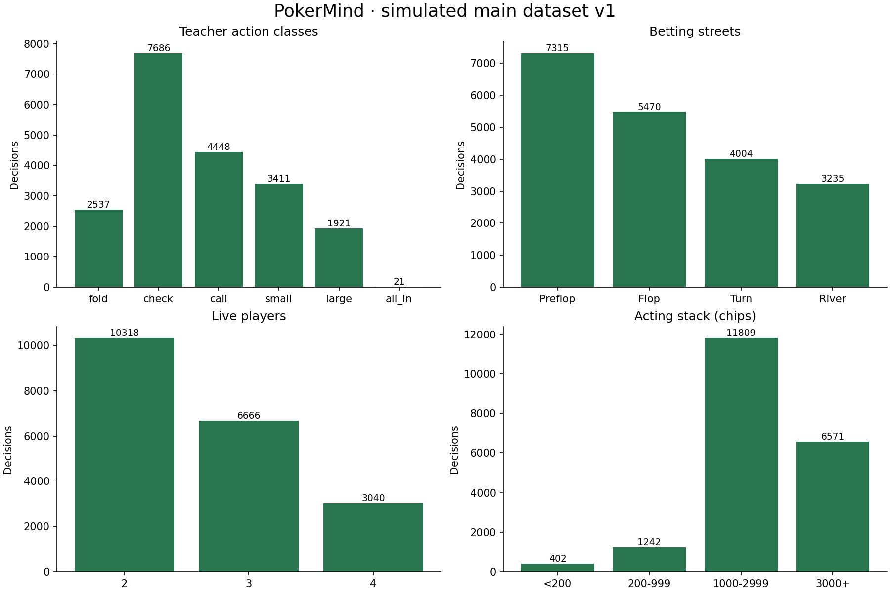
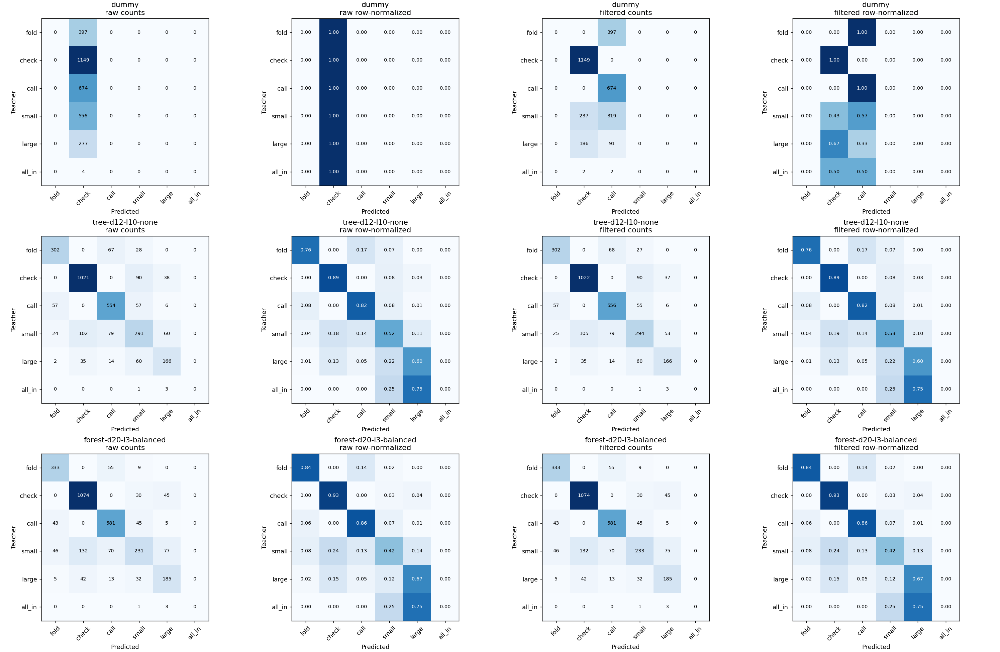
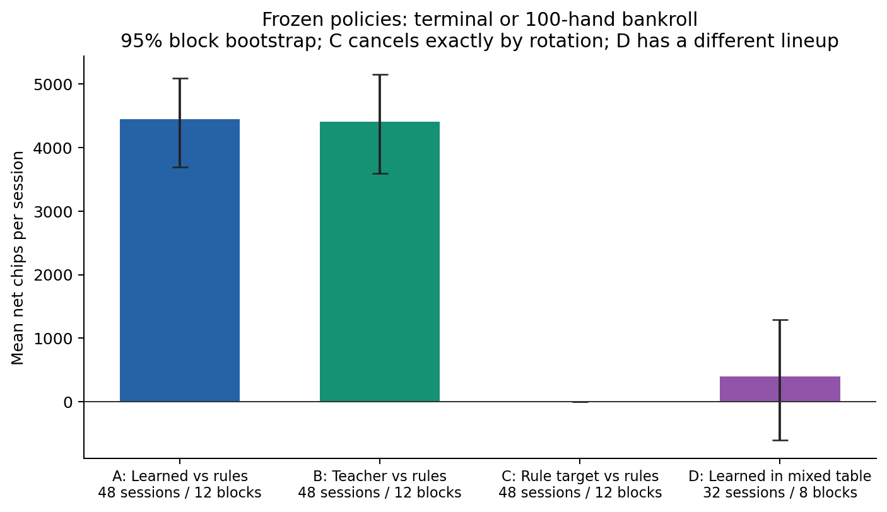
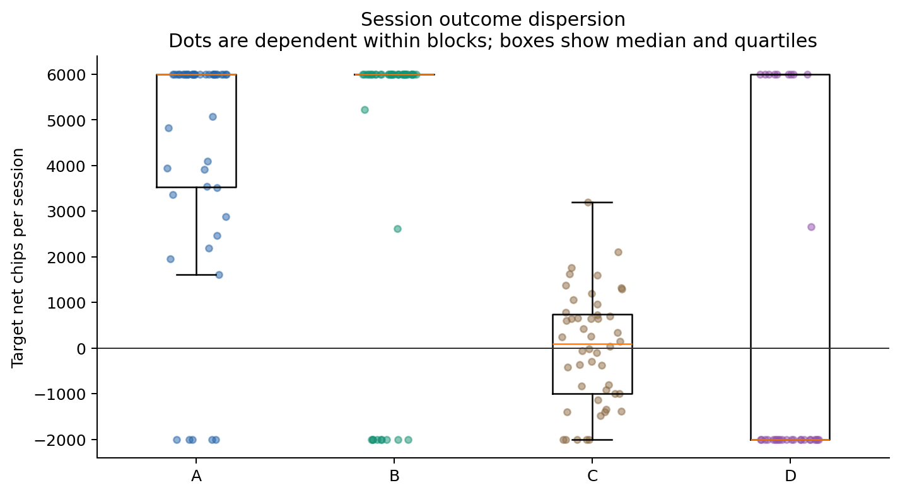
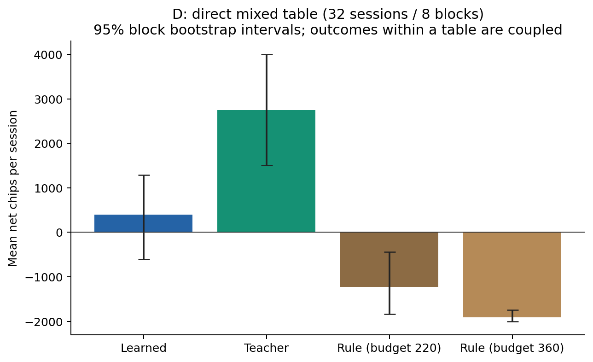
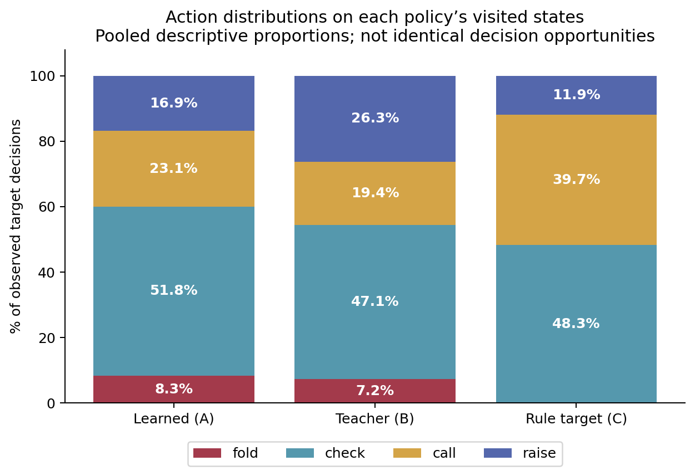

# Results summary — frozen PokerMind experiments

These are measurements under the documented simulated conditions, not claims of optimal poker. All values below are derived from the delivered data manifests, model results and Stage 6 checkpoints. Stage 8 did not retrain, relabel, rebalance or repeat model selection.

## Data and imitation learning

**20,024 accepted Teacher decisions**, **252 independently seeded sessions**, **54 permitted features**. Training: 14,156 decisions / 176 sessions; validation: 2,811 / 38; test: 3,057 / 38. Sessions, not individual decisions, define split groups.

| Locked finalist | Test raw accuracy | Test legal-filtered accuracy | Legal Macro-F1, 5 classes | Legal Macro-F1, 6 classes |
| --- | ---: | ---: | ---: | ---: |
| Dummy prior | 37.59% | 59.63% | 0.2938 | 0.2448 |
| Decision Tree, depth 12 / leaf 10 | 76.35% | 76.55% | 0.7222 | 0.6018 |
| Random Forest, 200 trees / depth 20 / leaf 3 / balanced | 78.64% | **78.70%** | **0.7360** | **0.6133** |

Source: [results.json](../models/imitation-v1/results.json). Validation, not test, selected the forest. Five-class Macro-F1 averages fold/check/call/small/large after computing per-class metrics on all test rows. The sixth class remains in the dataset and reports. There are **only four standalone all_in test examples**; all finalists missed all four. It is therefore misleading to describe 78.70% as uniformly good performance on all actions.

The prior baseline also benefits from the same external legal adapter, which explains why its filtered accuracy exceeds its raw majority-class score. Neither legality filtering nor agreement with the Teacher is evidence of learned optimal rules or hand-winning probability.

[Detailed quality and label-noise findings](data-quality.md) · [Training procedure](training-report.md) · [Model Card](model-card.md)

## Independent playing evaluation

The unchanged model, Teacher and RuleBots were tested with fixed 2,000-chip initial stacks, 10/20 blinds, four-seat rotation and at most 100 completed hands per session. Main scenarios share 12 seed blocks; mixed D uses eight. All **176 sessions / 12,601 hands** completed as planned: **100 true tournament finishes, 76 hand limits, zero errors**.

| Scenario | Sessions | Hands | Mean target net chips | Approximate 95% block interval |
| --- | ---: | ---: | ---: | --- |
| A: Learned vs three RuleBots | 48 | 3,720 | +4,445.31 | [3,697.00, 5,093.96] |
| B: Teacher vs three RuleBots | 48 | 2,666 | +4,413.17 | [3,596.08, 5,150.56] |
| C: marked RuleBot vs three RuleBots | 48 | 4,800 | 0.00 | [0.00, 0.00], structural symmetry |
| D: Learned vs Teacher and two RuleBots | 32 | 1,415 | +395.625, exact mean | [−604.38, 1,291.25] |

C's zero is a verified cancellation across identical physical-seat trajectories when the marked identity rotates; it is not proof of zero uncertainty for all rule strategies. D's exact mean is shown to avoid inconsistent half-cent rounding in historical two-decimal displays.

The paired main-scenario **Learned minus Teacher difference is +32.15 chips**, interval **[−551.87, +631.24]**. Under this setup both perform well against the simple rules; the data do not resolve a difference between them and do not prove equivalence. Individual-session standard deviations are 2,568.24 (A) and 3,152.91 (B), so large fluctuations remain visible.

In D, Teacher averages +2,750 chips. The within-table Learned−Teacher contrast is **−2,354.38 [−4,604.38, −208.75]**. This supplementary result suggests an advantage for Teacher in this lineup, subject to eight independent blocks and exploratory comparisons. It does not contradict the unresolved A/B gap: opponents and visited states differ.

## Action patterns and interpretation

Learned checks more often in A (51.76%) and raises less often (16.88%) than Teacher in B (47.12% and 26.27%). These pooled frequencies describe different visited state distributions; they are not a controlled causal test of aggression. Learned predicts no standalone all_in labels in A/D, but makes **34 actual all-in actions in A and 50 in D** through calls or clipped raises. Rare-label underrepresentation is a plausible weakness, not a proven cause of the mixed-table outcome.

Bootstrap intervals resample **complete seed blocks**, preserving the dependence among rotations. Individual hands are not independent observations. Tournament caps are not victories, and chip changes are not ordinary cashgame winrates. The Teacher's uniform-range assumptions, finite-sample noise and no-future-betting approximation constrain labels; imitation adds model error. No human-player generalization, equilibrium or optimal-strategy claim is established.

[Full protocol, seeds, uncertainty and limitations](evaluation-report.md) · [Machine-readable summary](../evaluations/stage6-v1/summary.json) · [Actual run manifest](../evaluations/stage6-v1/manifest.json)
