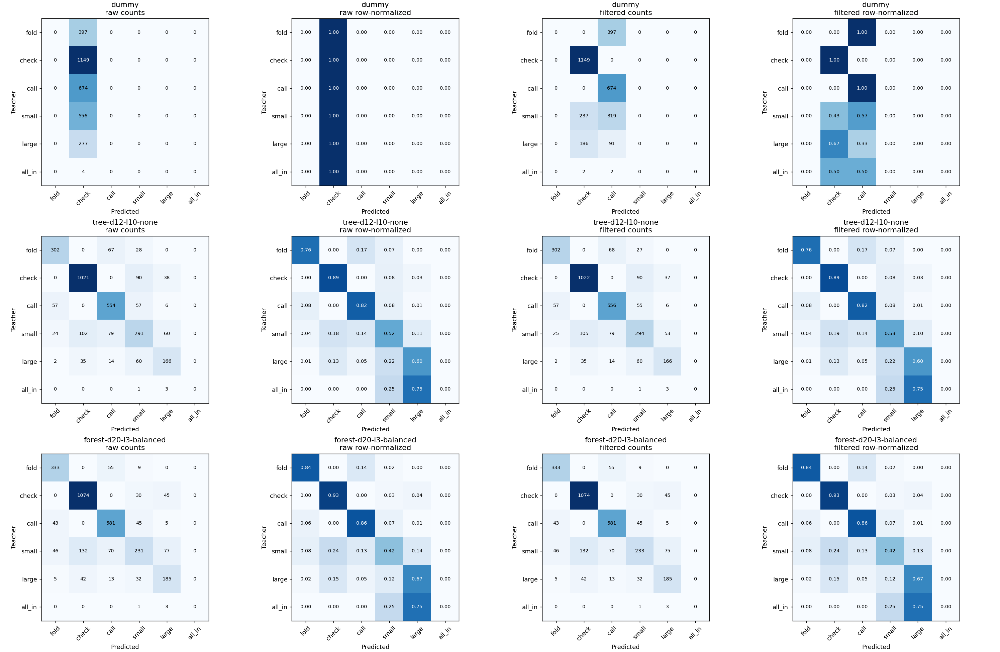

# Stage 4 training and evaluation report

This experiment measures imitation of the heuristic teacher on simulated data. It does not establish optimal poker decisions or playing strength. Browser integration is deliberately deferred to stage 5. Game rules, the moving button, existing opponents, data and fixed splits are unchanged.

## Predeclared procedure

`experiments/imitation-v1.json` was written before evaluation and copied into the package. Train-only fit: DummyClassifier(prior), six DecisionTreeClassifier configurations and six RandomForestClassifier configurations. Depth/leaf pairs (6,20), (12,10), (20,3), each unweighted and balanced; forests use 200 trees, two workers. Seed 20261107 throughout. Balanced weights derive only from training labels. No preprocessing, imputation, resampling, feature selection or new data. All 54 integer features are validated and loaded in the frozen order using the shared extractor/allowlist; no teacher estimates or future information enter X.

Primary selection: validation legal-filtered Macro-F1 over fold/check/call/small/large. Compute per-class metrics on ALL rows (including all_in targets), then average those five F1 values. Six-class Macro-F1 and accuracy remain reported. Fixed labels are always present; undefined precision/recall/F1 use zero. Exact score ties prefer tree, shallower depth, larger leaves, then no weighting. No search expansion and no train+validation refit.

The selected family finalists, validation results, model hashes and overall winner were saved in `selection.json` BEFORE test performance was computed. `events.json` records phase timestamps. Only the baseline and locked finalists were tested. No post-test parameter, fallback or winner change.

## Data audit and class support

All manifest file hashes and schema/order were verified; session assignments and disjointness checked. Raw protected observations were used to recalculate and verify the feature vectors. No split changed.

| Class | Train | Validation | Test |
| --- | ---: | ---: | ---: |
| fold | 1792 | 348 | 397 |
| check | 5453 | 1084 | 1149 |
| call | 3157 | 617 | 674 |
| small | 2368 | 487 | 556 |
| large | 1371 | 273 | 277 |
| all_in | 15 | 2 | 4 |

Rows: {'train': 14156, 'validation': 2811, 'test': 3057}; sessions: {'train': 176, 'validation': 38, 'test': 38}. All six classes occur in training; the missing-class zero-fill path is nevertheless tested.

## Probability adapter

The same adapter is used by all three families. `classes_` maps probabilities into the fixed six-class order; absent classes receive zero. Record raw argmax first; then remove illegal candidates using the existing candidate function and choose maximum remaining probability. Exact ties use fixed class order. If every legal probability is zero, choose check, fold, call, small, large, all_in in that priority among legal candidates; count it as a fallback. No Teacher or Monte Carlo call is involved. No-legal-action observations raise ValueError.

Candidate deduplication and raise-to mapping are unchanged. Short all-in calls are call; clipped raises may retain small/large labels. Adapter legality is externally enforced, not evidence of learned poker rules. Probabilities are neither poker win probabilities nor calibrated confidence estimates.

## All validation candidates

| Candidate | Fit s | Raw F1-5 | Legal F1-5 | Raw F1-6 | Legal F1-6 | Raw acc | Legal acc | Illegal % | Fallback % |
| --- | ---: | ---: | ---: | ---: | ---: | ---: | ---: | ---: | ---: |
| dummy | 0.002 | 0.1113 | 0.2958 | 0.0928 | 0.2465 | 0.3856 | 0.6051 | 47.78 | 0.00 |
| tree-d6-l20-none | 0.066 | 0.6551 | 0.6565 | 0.5459 | 0.5471 | 0.7325 | 0.7332 | 0.14 | 0.00 |
| tree-d6-l20-balanced | 0.070 | 0.6633 | 0.6657 | 0.5651 | 0.5686 | 0.7126 | 0.7147 | 0.28 | 0.00 |
| tree-d12-l10-none | 0.098 | 0.7003 | 0.7018 | 0.5836 | 0.5848 | 0.7535 | 0.7545 | 0.14 | 0.04 |
| tree-d12-l10-balanced | 0.103 | 0.6948 | 0.6993 | 0.5986 | 0.6050 | 0.7200 | 0.7239 | 0.46 | 0.00 |
| tree-d20-l3-none | 0.111 | 0.6733 | 0.6735 | 0.5611 | 0.5613 | 0.7261 | 0.7261 | 0.14 | 0.07 |
| tree-d20-l3-balanced | 0.119 | 0.6615 | 0.6625 | 0.5512 | 0.5521 | 0.6976 | 0.6987 | 0.14 | 0.04 |
| forest-d6-l20-none | 0.611 | 0.5785 | 0.5792 | 0.4821 | 0.4826 | 0.7161 | 0.7165 | 0.04 | 0.00 |
| forest-d6-l20-balanced | 0.613 | 0.6187 | 0.6195 | 0.5601 | 0.5676 | 0.7133 | 0.7140 | 0.14 | 0.00 |
| forest-d12-l10-none | 0.928 | 0.6809 | 0.6816 | 0.5674 | 0.5680 | 0.7641 | 0.7645 | 0.04 | 0.00 |
| forest-d12-l10-balanced | 0.947 | 0.6945 | 0.6952 | 0.5788 | 0.5793 | 0.7584 | 0.7588 | 0.07 | 0.00 |
| forest-d20-l3-none | 1.148 | 0.7051 | 0.7051 | 0.5875 | 0.5875 | 0.7755 | 0.7755 | 0.00 | 0.00 |
| forest-d20-l3-balanced | 1.178 | 0.7288 | 0.7294 | 0.6073 | 0.6078 | 0.7844 | 0.7848 | 0.04 | 0.00 |

**Validation-selected winner: forest-d20-l3-balanced.** Total measured fit time across 13 estimators: 5.993 seconds. These are fit times; validation, integrity checks, serialization and reporting add overhead.

## Finalists: training, validation and locked test

| Model | Split | N | Raw F1-5 | Legal F1-5 | Raw F1-6 | Legal F1-6 | Raw acc | Legal acc | Illegal % | Fallback % |
| --- | --- | ---: | ---: | ---: | ---: | ---: | ---: | ---: | ---: | ---: |
| dummy | train | 14156 | 0.1112 | 0.2971 | 0.0927 | 0.2476 | 0.3852 | 0.6082 | 47.91 | 0.00 |
| dummy | validation | 2811 | 0.1113 | 0.2958 | 0.0928 | 0.2465 | 0.3856 | 0.6051 | 47.78 | 0.00 |
| dummy | test | 3057 | 0.1093 | 0.2938 | 0.0911 | 0.2448 | 0.3759 | 0.5963 | 48.51 | 0.00 |
| tree-d12-l10-none | train | 14156 | 0.8123 | 0.8143 | 0.6769 | 0.6786 | 0.8450 | 0.8466 | 0.16 | 0.00 |
| tree-d12-l10-none | validation | 2811 | 0.7003 | 0.7018 | 0.5836 | 0.5848 | 0.7535 | 0.7545 | 0.14 | 0.04 |
| tree-d12-l10-none | test | 3057 | 0.7194 | 0.7222 | 0.5995 | 0.6018 | 0.7635 | 0.7655 | 0.36 | 0.07 |
| forest-d20-l3-balanced | train | 14156 | 0.9485 | 0.9485 | 0.9571 | 0.9571 | 0.9566 | 0.9566 | 0.00 | 0.00 |
| forest-d20-l3-balanced | validation | 2811 | 0.7288 | 0.7294 | 0.6073 | 0.6078 | 0.7844 | 0.7848 | 0.04 | 0.00 |
| forest-d20-l3-balanced | test | 3057 | 0.7349 | 0.7360 | 0.6124 | 0.6133 | 0.7864 | 0.7870 | 0.07 | 0.00 |
## Test class metrics (every class retained)

### dummy

| Class | N | Raw precision | Raw recall | Raw F1 | Legal precision | Legal recall | Legal F1 |
| --- | ---: | ---: | ---: | ---: | ---: | ---: | ---: |
| fold | 397 | 0.0000 | 0.0000 | 0.0000 | 0.0000 | 0.0000 | 0.0000 |
| check | 1149 | 0.3759 | 1.0000 | 0.5464 | 0.7300 | 1.0000 | 0.8439 |
| call | 674 | 0.0000 | 0.0000 | 0.0000 | 0.4545 | 1.0000 | 0.6249 |
| small | 556 | 0.0000 | 0.0000 | 0.0000 | 0.0000 | 0.0000 | 0.0000 |
| large | 277 | 0.0000 | 0.0000 | 0.0000 | 0.0000 | 0.0000 | 0.0000 |
| all_in | 4 | 0.0000 | 0.0000 | 0.0000 | 0.0000 | 0.0000 | 0.0000 |
### tree-d12-l10-none

| Class | N | Raw precision | Raw recall | Raw F1 | Legal precision | Legal recall | Legal F1 |
| --- | ---: | ---: | ---: | ---: | ---: | ---: | ---: |
| fold | 397 | 0.7844 | 0.7607 | 0.7724 | 0.7824 | 0.7607 | 0.7714 |
| check | 1149 | 0.8817 | 0.8886 | 0.8851 | 0.8795 | 0.8895 | 0.8845 |
| call | 674 | 0.7759 | 0.8220 | 0.7983 | 0.7755 | 0.8249 | 0.7994 |
| small | 556 | 0.5522 | 0.5234 | 0.5374 | 0.5579 | 0.5288 | 0.5429 |
| large | 277 | 0.6081 | 0.5993 | 0.6036 | 0.6264 | 0.5993 | 0.6125 |
| all_in | 4 | 0.0000 | 0.0000 | 0.0000 | 0.0000 | 0.0000 | 0.0000 |
### forest-d20-l3-balanced

| Class | N | Raw precision | Raw recall | Raw F1 | Legal precision | Legal recall | Legal F1 |
| --- | ---: | ---: | ---: | ---: | ---: | ---: | ---: |
| fold | 397 | 0.7799 | 0.8388 | 0.8083 | 0.7799 | 0.8388 | 0.8083 |
| check | 1149 | 0.8606 | 0.9347 | 0.8961 | 0.8606 | 0.9347 | 0.8961 |
| call | 674 | 0.8081 | 0.8620 | 0.8342 | 0.8081 | 0.8620 | 0.8342 |
| small | 556 | 0.6638 | 0.4155 | 0.5111 | 0.6657 | 0.4191 | 0.5143 |
| large | 277 | 0.5873 | 0.6679 | 0.6250 | 0.5911 | 0.6679 | 0.6271 |
| all_in | 4 | 0.0000 | 0.0000 | 0.0000 | 0.0000 | 0.0000 | 0.0000 |
## Test by street

| Model | Street | N | Raw F1-5 | Legal F1-5 | Raw acc | Legal acc |
| --- | --- | ---: | ---: | ---: | ---: | ---: |
| dummy | Preflop | 1170 | 0.0536 | 0.3070 | 0.1547 | 0.4957 |
| dummy | Flop | 811 | 0.1299 | 0.2935 | 0.4809 | 0.6301 |
| dummy | Turn | 597 | 0.1413 | 0.3183 | 0.5461 | 0.6935 |
| dummy | River | 479 | 0.1379 | 0.3123 | 0.5261 | 0.6639 |
| tree-d12-l10-none | Preflop | 1170 | 0.8074 | 0.8135 | 0.8299 | 0.8325 |
| tree-d12-l10-none | Flop | 811 | 0.6540 | 0.6570 | 0.7287 | 0.7312 |
| tree-d12-l10-none | Turn | 597 | 0.6037 | 0.6069 | 0.7270 | 0.7286 |
| tree-d12-l10-none | River | 479 | 0.5768 | 0.5768 | 0.7056 | 0.7056 |
| forest-d20-l3-balanced | Preflop | 1170 | 0.7941 | 0.7941 | 0.8188 | 0.8188 |
| forest-d20-l3-balanced | Flop | 811 | 0.6882 | 0.6882 | 0.7608 | 0.7608 |
| forest-d20-l3-balanced | Turn | 597 | 0.6314 | 0.6375 | 0.7688 | 0.7722 |
| forest-d20-l3-balanced | River | 479 | 0.6791 | 0.6791 | 0.7724 | 0.7724 |

Rows are teacher labels, columns predictions. Zero-support rows normalize to zero. Full precision/recall/support and raw/filtered confusion matrices for train, validation and test, plus all candidate validation metrics and street breakdowns, are in the package JSON files.

## Actual validation examples

| Record | Street | Own cards | Teacher | Raw | Legal | Concrete action |
| --- | --- | --- | --- | --- | --- | --- |
| s000100001:a000003 | Preflop | Jh 3h | call | call | call | {'action': 'call', 'amount': None} |
| s000100001:a000004 | Preflop | Ad 4s | check | check | check | {'action': 'call', 'amount': None} |
| s000100001:a000014 | River | Ad 4s | large | check | check | {'action': 'call', 'amount': None} |
| s000100001:a000024 | Flop | 2s 9d | small | check | check | {'action': 'call', 'amount': None} |

## Timing, interpretation and limits

Winner train vs validation F1-5: 0.9485 vs 0.7294; gap 0.2191. This is a measured indication of generalization loss/possible overfitting, not a causal diagnosis. Locked test F1-5: 0.7360, compared with prior baseline 0.2938. The winner was NOT switched after seeing test.

Inference: 200 sequential validation observations, 10 warmup calls excluded, mean **12.840 ms**, p95 **13.236 ms**. Includes feature extraction, predict_proba and legal adapter. Model loading separately measured at **93.445 ms**, in an already initialized Python process (not cold application startup). Environment: macOS-15.5-arm64-arm-64bit, arm, Python 3.11.9; libraries {'scikit-learn': '1.7.2', 'numpy': '2.4.6', 'scipy': '1.17.1', 'joblib': '1.5.2', 'pokerkit': '0.7.7'}. No direct speedup claim against earlier Teacher times: workloads and conditions differ.

Only 21 independent all_in-class targets exist: 15 train, 2 validation, 4 test. Per-class test results are descriptive, not statistically robust. The six separate all-in scenarios are functional fixtures, not representative performance evidence, and were not used for model selection or measured imitation scores. Label noise and policy-dependent simulated states limit interpretation. The 41 boundary-enriched pilot states cannot estimate population error or an accuracy ceiling. Class probabilities are uncalibrated imitation scores, not poker equities. No opponent-play evaluation or browser integration was performed.

## Reproduction and evidence

See Model Card and README for exact commands. Packages use trusted-local joblib serialization; do not load untrusted pickle/joblib files. Loading checks artifact hash, sklearn version, feature order/schema and class/action mapping. Stored models are the exact train-only finalists, never refitted on train+validation. Reload equality and teacher-free inference are tested. `events.json`, `selection.json`, `metadata.json`, `validation.json`, `results.json`, prediction JSONL, `latency.json` and `data-audit.json` preserve machine-readable evidence. The original dataset hashes remain unchanged.

scikit-learn documentation: [RandomForestClassifier](https://scikit-learn.org/1.7/modules/generated/sklearn.ensemble.RandomForestClassifier.html), [model persistence](https://scikit-learn.org/1.7/model_persistence.html). No learned preprocessing is needed for these validated integer tree inputs.

## Executed regression checks and implementation correction

**45 tests passed** (all previous 40 plus five new tests); see `stage4-tests.txt`. New coverage includes classes_ reordering/missing classes, zero-probability legal fallback and tie order, no-action errors, short all-in-call and raise mapping, save/reload behavior, exact action equality between loaded agents, strict feature-order rejection, teacher/Monte-Carlo-free inference and five-class metric computation without dropping all_in rows. Dependency consistency (`pip check`) passed. The existing Starlette/httpx test-client deprecation warning remains.

A first serialization assertion used exact bitwise equality of parallel forest probabilities and failed before any test evaluation. This was a verification issue caused by floating-point summation order. It was corrected to tight numerical tolerance (rtol=1e-13, atol=1e-15) plus exact argmax checks. The already trained finalists and recorded validation scores were reused; no new configurations or retraining were introduced. Finalists, hashes and winner were then locked before test evaluation. Tiny probability rounding differences across parallel calls may remain; the tested predictions and actions are preserved. No parameters or fallback rules changed after test results.

The standalone all_in class was not correctly predicted by any finalist or the baseline on its four test cases (precision/recall/F1 all zero). The saved-model evaluation command was also executed independently: its raw and filtered metrics matched the original recorded test metrics exactly. No retraining or reselection occurred.
