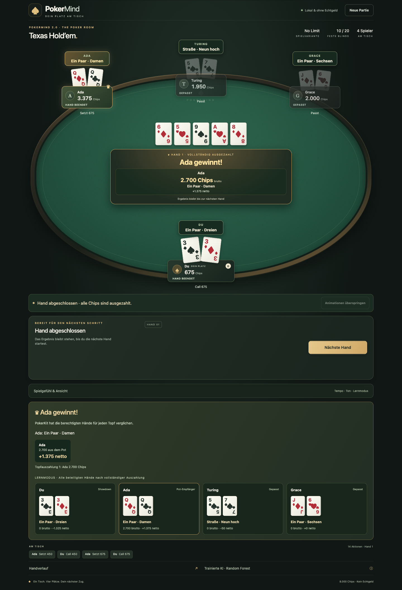

# Readable turns, stable controls and in-table results

Verified locally on 8 November 2026 on `feature/pokermind-2-experience`. This supersedes the initial 2.0 pacing assessment; the previous report remains historical evidence. No public release or push was made. No production Python game, agent or server code changed in this revision. The trained model, Teacher, data, splits, rules and scientific evaluation are unchanged.

## Changes and measured timing

Each real bot turn now has two serial phases: highlight the actual current player and show “Ada ist am Zug …”, then request one server operation and retain that player's highlight with the actual action. The next decision cannot start until this reading interval completes. Card dealing, board reveal, collection and payout remain separate real server operations, not fabricated replay frames.

| Mode | Thinking | Action reading | Completed-hand celebration |
| --- | ---: | ---: | ---: |
| Normal, default | 1,250 ms | 1,750 ms | 4,000 ms |
| Schnell | 300 ms | 600 ms | 1,200 ms |
| Sofort | 0 ms | 0 ms | 0 ms |

Times are centralized in `pokermind/static/experience.mjs`. Reduced motion suppresses movement, not reading time. Sofort removes deliberate waits. Fetch, inference and browser scheduling add latency.

In the instrumented real-model hand, seven bot actions lasted **3.03–3.05 seconds each**: thinking 1.28–1.30 seconds and action reading 1.75–1.76 seconds. The completed-hand hold measured 4.01 seconds. The result remained visible afterward until explicitly starting another hand. [Timestamped browser phases and control measurements](timing-controls.json).

## Flicker fix

The old action rendering rebuilt the controls on state updates. `ActionPanel` now mounts input, slider, presets and buttons once. Subsequent events patch text, legal bounds and disabled states in place. A display refresh with the same decision identity preserves the entered amount; a new real decision may reset it to valid current bounds. No animation moves focus. All controls stay disabled during foreign turns and pending commands; commands still use server epoch/version checks.

The action panel and status strip reserve space in every phase. Browser testing found an additional nine-pixel mobile shift caused by long settlement/elimination headings. Short headings and sufficient reserved heading space fixed that cause too.

The final three-mode check sampled each animation frame through complete hands: **zero replaced controls, zero foreign-turn-enabled actions, zero thinking-phase scroll jumps**. Panel height stayed exactly 228 px at 1280 px width, 345 px at 768 px and 450 px at 390 px; document position stayed constant too. The independent repeat using the delivered regression script also passed. [Initial final-mode measurements](modes-controls.json) · [Repeatable-script results](browser-regression.json).

## Hand labels and winners

PokerKit-derived descriptions sit directly above each player's cards. Winning badges are gold. They persist through settlement until the next hand. The learning view can display folded cards only after full payout; a folded strong hand does not become a winner. The realistic view keeps undisclosed opponents masked. Fold victories say **Gewonnen durch Fold** rather than crediting a hypothetical combination.

After final settlement, an elegant central panel fades/scales in, with all actual recipients, each gross payout, separate net change, and the server's actual payout allocations. Chips animate from real allocation events; credited stacks come from the server. Split pots and side pots do not become fictitious single-winner results. PokerKit can consolidate pot layers; payout sequence numbers are not persistent main/side-pot identifiers. The result remains indefinitely; only **Nächste Hand** advances play.



[Ada thinking](ada-thinking.png) · [Ada's real raise](ada-action.png) · [Persistent winner](victory-persistent.png) · [Split pot, four recipients](split-desktop.png) · [Side-pot recipients](side-pots-desktop.png).

## Browser acceptance

Real Chrome browser sessions played complete hands against all three frozen LearnedAgents in Normal, Schnell and Sofort, including a touch-emulated phone. These exercised dealing, flop/turn/river, check/call/raise/fold, chip movement, showdown, settlement, next hand and reset. A typed draft survived a display-only settings refresh. Enter executed a valid raise; an invalid amount disabled the raise button. Additional checks covered reload mid-hand, reset during thinking, offline recovery, skipping, stored settings, reduced motion, realistic masking and 8,000-chip conservation. [Recovery results](recovery.json).

Six deterministic **real PokerKit QA fixtures**, separate from the application and model-performance evidence, covered side pots/all-in settlement, a four-way Royal Flush split, fold victory, champion, heads-up and an eliminated human. Each was checked at **1440×900, 1280×800, 768×1024 and 390×844**: 24 layouts, no horizontal overflow or intersections between result panels, board, cards and player badges. [Geometry measurements](layout-checks.json). Screenshots were inspected visually as well.

Actual Chrome **200% browser zoom**, not CSS scale, was set through the native browser menu. A full heads-up fixture hand was played to showdown, followed by next hand and reload. Human actions, disabled bot controls and central results remained operable with vertical scrolling. Zoom was restored to 100% afterward. [Zoom confirmation](zoom-200-confirmation.png) · [Human controls](zoom-200-human.png) · [Locked controls](zoom-200-controls.png) · [Winner](zoom-200-winner.png) · [Reload](zoom-200-reload.png).

Responsive evidence: [1280×800](fast-hand-1280.png), [768×1024](instant-hand-768.png), [390×844](normal-hand-390.png), [mobile split](split-phone.png), [mobile side pots](side-pots-phone.png), [elimination](eliminated-phone.png), [fold](fold-tablet.png), [champion](champion-desktop.png), [reduced motion](reduced-motion-result.png). Most page screenshots include the full scrollable page, not just the viewport.

### Full-hand recording

[Normal-speed full hand, WebM](normal-complete-hand.webm): **55.48 seconds, VP9, 25 fps, 1440×1500**. This deliberately tall capture shows table and controls together; the required smaller viewports were checked separately. It records a separate real-model hand with complete settlement and a persistent result, without speeding up playback. Sound was off; this is not an audio-quality assessment.

## Automated verification and reproduction

**94 Python + 20 JavaScript tests = 114 passed, zero failed**, including all previous 107 tests. Seven new tests cover timing/modes, reduced motion, control modes/decision identity, privacy-safe seat descriptions, real multi-recipient receipts and cancellation before inference. [Python transcript](pytest.txt) · [JavaScript transcript](node-tests.txt). One preexisting Starlette/httpx deprecation warning remains. All **558 protected original files** match their historical hashes: [artifact verification](frozen-check.json).

```sh
python -m pytest -q
node --test tests/*.test.mjs
python scripts/v2_verify.py
# Dedicated disposable QA instance; leave your playing table on port 8000 alone:
python -m uvicorn pokermind.server:app --host 127.0.0.1 --port 8002
# In another terminal (Node/npm and Chrome required):
python scripts/pace_browser_check.py --url http://127.0.0.1:8002
```

The script uses pinned `@playwright/cli@0.1.23`, resets the dedicated table and plays three complete hands. It asserts stable control nodes/geometry, disabled foreign actions and no thinking-phase scroll shifts, then exercises next hand and reset. Results and screenshots go to ignored `output/playwright/pace-regression`. Random games need not reproduce the same cards. Rare fixtures can be inspected with `python -m uvicorn scripts.v2_browser_fixtures:app --host 127.0.0.1 --port 8003`; see the script for its loopback routes. Production exposes no fixture endpoint.

For a portable local package, use `python scripts/stage8_package.py --output ../PokerMind-2.0-pace.zip`. This preserves the earlier archive and public v1.0.0. Packaging checks CRCs and every included byte; private materials, environments, work files and Git history are excluded.

## Portable-copy verification

The ZIP was extracted into a new independent directory. Both suites passed again there: **94 Python + 20 JavaScript, zero failures**, and saved-model inference returned a legal call without fallback. This check reused the separate Python 3.11.9 acceptance environment from the initial 2.0 verification, not the project environment; dependencies were not freshly downloaded for this revision. `pip check` passed. The final package adds these transcripts; its runtime, model, data and test bytes match the executed copy. [Portable Python tests](portable-python.txt) · [Portable JS tests](portable-node.txt) · [Saved inference](portable-model.json).

## Limits

Vertical scrolling is intentional, including on short desktop windows: table and controls reserve enough space for four winners without moving during a hand. The table does not fit entirely into every tested viewport. Measurements apply to the tested macOS Chrome sessions, not all hardware. Mobile was emulated, not a physical phone; screen-reader speech and audible sound quality were not independently assessed. Rare-state fixtures verify correct engine/UI projection, not new scientific AI performance. Reduced motion still retains Normal reading pauses; choose Sofort to remove waits. One local in-memory table, one playing tab and one server process remain the supported setup. Reload restores authoritative current state, not missed animation history. No GitHub Actions run was triggered because this revision remains local.
